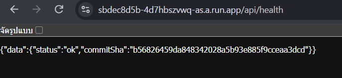
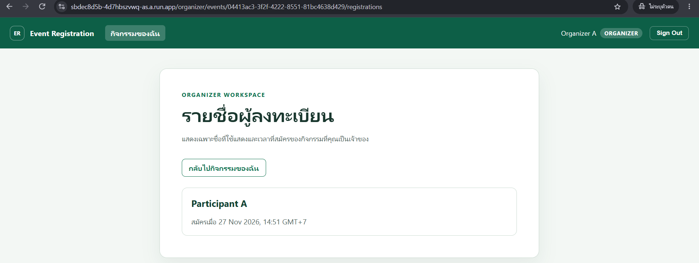
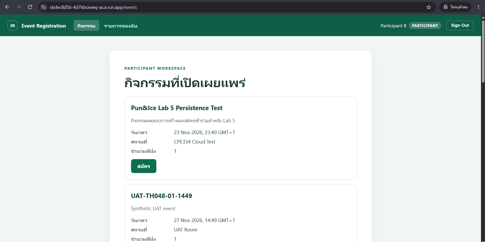
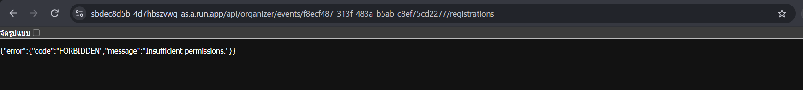
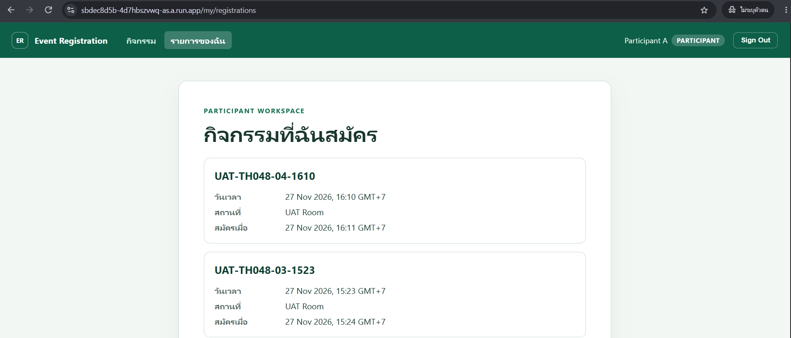
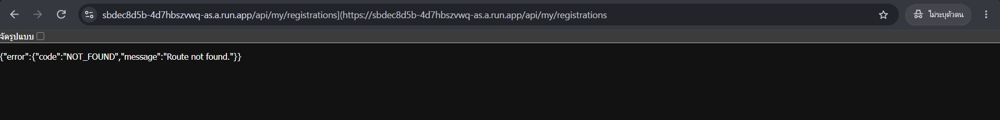
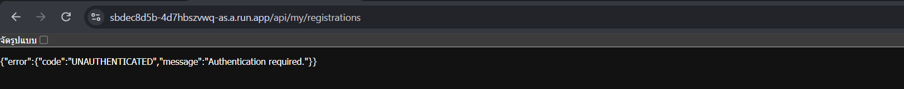
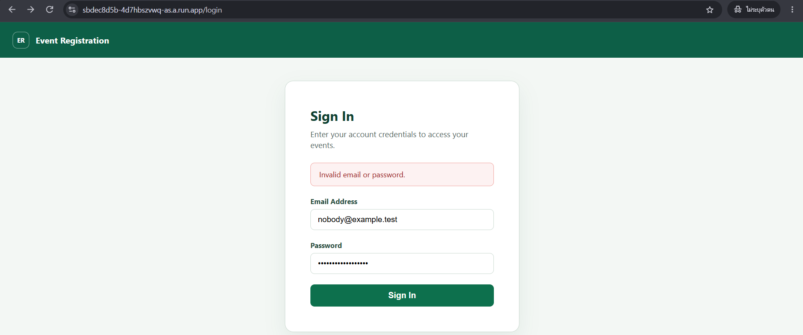

# Lab 6 Part B — Independent UAT Execution Report

**การทดสอบโดยทีม UAT อิสระ TH-048 ต่อผลิตภัณฑ์ของทีม TH-040 Pun&Ice**
**Independent UAT execution by TH-048 against Product Team TH-040 Pun&Ice**

> **สถานะเอกสาร / Document status:** Completed execution record — EVID-B-00 and UAT-01–UAT-05 are recorded; UAT-04 passed after the clean-URL retest. Preserve the observation trail and evidence links; do not replace observed results with expected behavior. If a future pre-test version check does not match, stop testing and notify the Product Team.
>
> **ความปลอดภัย / Security:** Never record passwords, cookies, session tokens, or other secrets in this Markdown file, screenshots, or final PDF. Account identifiers below are email addresses only.

## 1. Header & Environment Verification Metadata

| Metadata | Value / observed record |
|---|---|
| Lab / Part | CPE334 Lab 6 — Part B: Independent UAT Execution |
| UAT Team | `TH-048` |
| Tester | ภานุวัฒน์ — Sole Tester |
| Product Team | `TH-040 Pun&Ice` |
| Product Team contacts | `Khawpun124`, `Davidice23` |
| Partner Repository | https://github.com/Davidice23/event-registration-attendance |
| Partner UAT Plan | https://github.com/Davidice23/event-registration-attendance/blob/staging/docs/labs/lab-06/uat-plan.md |
| Deployed Application URL | https://sbdec8d5b-4d7hbszvwq-as.a.run.app/ |
| Target Cloud Run Revision | `sbdec8d5b-00007-ld2` |
| Expected `commitSha` (`/api/health`) | `b56826459da848342028a5b93e885f9cceaa3dcd` |
| Pre-test `/api/health` observed output | `{"commitSha":"b56826459da848342028a5b93e885f9cceaa3dcd"}` |
| Pre-test check timestamp (ICT, UTC+7) | `27 Nov 2026, 14:48 GMT+7` |
| Version gate decision | **MATCH** — observed `commitSha` matched the expected release baseline |
| Browser / device used | `[TO BE FILLED]` |

**Entry gate / เงื่อนไขก่อนเริ่ม:** Open the deployed application's `/api/health` endpoint and compare the observed `commitSha` with the expected value above. Continue only if it matches. Record the exact response and time in `EVID-B-00`. If the value differs or cannot be verified, stop and contact the Product Team; do not mark any case PASS.

**Test data safety / ความปลอดภัยของข้อมูลทดสอบ:** Each case creates its own event named `UAT-TH-048-<case>-<HHMM>` (for example, `UAT-TH-048-01-1430`), with future start time, location `UAT Room`, and description `Synthetic UAT event`, as applicable to the case. The shared deployment does not support deleting events or registrations; use only new synthetic data. Do not register for, modify, or otherwise use `Pun&Ice Lab 5 Persistence Test` or any event whose name begins `UAT-PunIce-DRY-`. Sign out before switching accounts or use separate private windows. Record only the test data necessary to reproduce observations; never record credentials.

## 2. UAT Execution Results Summary

For `Tested commitSha`, record the `commitSha` actually observed from `/api/health` for the run. For `Actual Result`, record only behavior observed during execution. Use one evidence ID per case and link it to the detailed block below.

| Case ID | Test Category & Scope (AC) | Tester | Date & Time (ICT) | Tested commitSha | Test Inputs Used | Actual Result (Observed Behavior — do not copy expected results) | Status (PASS/FAIL/BLOCKED) | Evidence ID |
|---|---|---|---|---|---|---|---|---|
| UAT-01 | Normal domain journey: publish event → participant registration → organizer views roster. FR-01–FR-04; AC-01, AC-04, AC-07, AC-11 | ภานุวัฒน์ (TH-048) | 27 Nov 2026, 14:49–14:52 GMT+7 | `b56826459da848342028a5b93e885f9cceaa3dcd` | Event `UAT-TH048-01-1449`; description `Synthetic UAT event`; start `27 Nov 2026, 14:49 GMT+7`; location `UAT Room`; capacity `2`; registered by `participant-a@example.test` | Organizer A published the event. Participant A saw it on `/events`, registered, and saw `สมัครเมื่อ 27 Nov 2026, 14:51 GMT+7` on `/my/registrations`. Organizer A saw the privacy notice and one roster entry for Participant A with the same registration time; no email or PII was shown. | PASS | EVID-B-01 |
| UAT-02 | Business rules / boundaries: seat count, duplicate registration, full event. BR-01–BR-03; AC-05, AC-08, AC-09 | ภานุวัฒน์ (TH-048) | 27 Nov 2026, 15:11–15:18 GMT+7 | `b56826459da848342028a5b93e885f9cceaa3dcd` | Event `UAT-TH048-02-1511`; description `Synthetic UAT event`; start `27 Nov 2026, 15:11 GMT+7`; location `UAT Room`; capacity `0`, then `1`; Participant A duplicate submission across two tabs, then Participant B registration attempt | Capacity `0` was rejected; capacity `1` published successfully. Participant A registered at 15:16 in Tab 1; Tab 2 displayed the duplicate-registration message without adding a duplicate. Participant B saw the full-event message and disabled button; the event did not appear in B's registrations. Organizer A's roster showed only Participant A. | PASS | EVID-B-02 |
| UAT-03 | Authorization and ownership: organizer/participant access restrictions and roster data isolation. BR-04, NFR-02; AC-04, AC-06, AC-10, AC-12 | ภานุวัฒน์ (TH-048) | 27 Nov 2026, 15:23–15:50 GMT+7 | `b56826459da848342028a5b93e885f9cceaa3dcd` | Event `UAT-TH048-03-1523`; description `Synthetic UAT event`; start `27 Nov 2026, 15:23 GMT+7`; location `UAT Room`; capacity `2`; registered by Participant A; unauthorized roster UI/API access by Organizer B and Participant B | Organizer B did not see Organizer A's event in “จัดการกิจกรรมของฉัน” and saw the no-access message on direct roster URL. Participant B was redirected to `/events` without roster data or publish forms and had no registration entry. Organizer A later confirmed the roster still contained only Participant A at the original timestamp, with no observed data leak or mutation. | PASS | EVID-B-03, EVID-B-03-api |
| UAT-04 | State, history, and persistence: registration after reload/re-login and private data after logout. NFR-01; AC-01, AC-03, AC-07, AC-11 | ภานุวัฒน์ (TH-048) | 27 Nov 2026, 16:10–16:38; retest 22:00 GMT+7 | `b56826459da848342028a5b93e885f9cceaa3dcd` | Event `UAT-TH048-04-1610`; description `Synthetic UAT event`; start `27 Nov 2026, 16:10 GMT+7`; location `UAT Room`; capacity `3`; Participant A registration; reload, sign-out, Back/direct unauthenticated UI/API access, and clean-URL retest in fresh Incognito | UI persistence and route protection worked: registration remained visible through reload and re-login; unauthenticated UI visits redirected to Sign In. Initial API attempt used a URL with an accidentally pasted Markdown-link suffix and returned `NOT_FOUND` (Issue #48, `EVID-B-04-api`). Retest with the clean URL in a fresh Incognito session returned `UNAUTHENTICATED` / `Authentication required.` as expected (`EVID-B-04-retest`). | PASS | EVID-B-04, EVID-B-04-api, EVID-B-04-retest |
| UAT-05 | Negative authentication: invalid credentials and unauthenticated API access. FR-01, NFR-02; AC-02 | ภานุวัฒน์ (TH-048) | 27 Nov 2026, 16:45–16:48 GMT+7 | `b56826459da848342028a5b93e885f9cceaa3dcd` | Unauthenticated Sign In attempts using `participant-a@example.test` and `nobody@example.test` with invalid credentials; direct unauthenticated `GET /api/auth/me` | Both attempts remained on Sign In and displayed the identical message `"Invalid email or password."`; the API returned `{"error":{"code":"UNAUTHENTICATED","message":"Authentication required."}}`. | PASS | EVID-B-05 |

### Status and evidence notes

- **PASS:** the executed behavior satisfies the applicable acceptance criteria based on observed evidence.
- **FAIL:** observed behavior violates one or more applicable acceptance criteria; record the exact behavior and report a finding to the Product Team.
- **BLOCKED:** the case could not be completed; record the concrete reason. BLOCKED is not PASS.
- Planned manual cases do not replace the automated concurrency/API coverage noted in the partner plan. Do not claim those automated checks as independently executed by TH-048.
- Use ICT (Thailand time, UTC+7) consistently. Keep screenshots readable and include the browser address bar for UAT-01 and UAT-03. Redact secrets and unrelated personal data.

## 3. Detailed Evidence Log

Complete each field immediately after the corresponding observation. The step-by-step record should describe what was actually seen, including visible text, navigation, HTTP response (when directly observed), and relevant before/after state. Do not transcribe expected results as actual results.

### EVID-B-00 — Pre-test version / environment check (`/api/health`)

| Field | Record |
|---|---|
| Evidence ID | `EVID-B-00` |
| Linked Case ID | Pre-test gate (applies to UAT-01–UAT-05) |
| Timestamp (ICT, UTC+7) | `27 Nov 2026, 14:48 GMT+7` |
| Target revision | `sbdec8d5b-00007-ld2` |
| Expected `commitSha` | `b56826459da848342028a5b93e885f9cceaa3dcd` |
| Tested commitSha (observed) | `b56826459da848342028a5b93e885f9cceaa3dcd` |
| Account Role Used (email only, NO password) | Unauthenticated / no account used |
| Step-by-Step Observed Behavior | Opened `https://sbdec8d5b-4d7hbszvwq-as.a.run.app/api/health`. Observed exact output `{"commitSha":"b56826459da848342028a5b93e885f9cceaa3dcd"}`; it matched the expected release baseline, so the version gate passed. |
| Authorization / Data-Leak Verification | The observed response contained the `commitSha` value shown above; no other response fields were reported. |
| Version gate decision | **MATCH** — UAT was allowed to proceed. |

### EVID-B-01 — UAT-01: Normal domain journey

| Field | Record |
|---|---|
| Evidence ID | `EVID-B-01` |
| Linked Case ID | `UAT-01` — Normal domain journey (FR-01–FR-04; AC-01, AC-04, AC-07, AC-11) |
| Timestamp (ICT, UTC+7) | `27 Nov 2026, 14:49–14:52 GMT+7` |
| Tested commitSha | `b56826459da848342028a5b93e885f9cceaa3dcd` |
| Account Role Used (email only, NO password) | Organizer A: `organizer-a@example.test`; Participant A: `participant-a@example.test` |
| Step-by-Step Observed Behavior | 1. Organizer A published `UAT-TH048-01-1449` successfully. 2. Participant A (`participant-a@example.test`) saw the event on `/events` and clicked register. 3. On `/my/registrations`, Participant A saw `สมัครเมื่อ 27 Nov 2026, 14:51 GMT+7`. 4. Organizer A opened the roster page and observed the privacy notice `"แสดงเฉพาะชื่อที่ใช้แสดงและเวลาที่สมัครของกิจกรรมที่คุณเป็นเจ้าของ"` and one entry: `Participant A`, `สมัครเมื่อ 27 Nov 2026, 14:51 GMT+7`. |
| Authorization / Data-Leak Verification | Organizer A's roster showed one Participant A entry. No email or other PII was shown in the observed roster. |

**Inputs used:** Event title `UAT-TH048-01-1449`; description `Synthetic UAT event`; start time `27 Nov 2026, 14:49 GMT+7`; location `UAT Room`; capacity `2`; registered by `participant-a@example.test`.

**Result:** **PASS**

### EVID-B-02 — UAT-02: Business rules and boundaries

| Field | Record |
|---|---|
| Evidence ID | `EVID-B-02` |
| Linked Case ID | `UAT-02` — Seat count, duplicate registration, full event (BR-01–BR-03; AC-05, AC-08, AC-09) |
| Timestamp (ICT, UTC+7) | `27 Nov 2026, 15:11–15:18 GMT+7` |
| Tested commitSha | `b56826459da848342028a5b93e885f9cceaa3dcd` |
| Account Role Used (email only, NO password) | Organizer A: `organizer-a@example.test`; Participant A: `participant-a@example.test`; Participant B: `participant-b@example.test` |
| Step-by-Step Observed Behavior | 1. Organizer A submitted event `UAT-TH048-02-1511` with capacity `0`; the capacity was rejected. 2. Organizer A changed capacity to `1` and published the event successfully. 3. Participant A (`participant-a@example.test`) registered in Tab 1 and saw `สมัครเมื่อ 27 Nov 2026, 15:16 GMT+7`. 4. Participant A submitted the same registration in Tab 2; the page displayed `"คุณสมัครกิจกรรม “UAT-TH048-02-1511” ไว้แล้ว"` and no duplicate entry appeared on `/my/registrations`. 5. Participant B (`participant-b@example.test`) attempted to register; the page displayed `"กิจกรรม “UAT-TH048-02-1511” เต็มแล้ว สมัครไม่สำเร็จ"`, showed a disabled `"เต็มแล้ว"` button, and the event did not appear in B's registrations. 6. Organizer A's roster showed one entry: `Participant A`, `สมัครเมื่อ 27 Nov 2026, 15:16 GMT+7`. |
| Authorization / Data-Leak Verification | Participant B had no registration entry for the full event. Organizer A's roster contained only Participant A; no Participant B entry was shown. |

**Inputs used:** Event title `UAT-TH048-02-1511`; description `Synthetic UAT event`; start time `27 Nov 2026, 15:11 GMT+7`; location `UAT Room`; initial capacity `0` (rejected), then capacity `1`; duplicate submission across two browser tabs by `participant-a@example.test`; registration attempt by `participant-b@example.test`.

**Result:** **PASS**

### EVID-B-03 — UAT-03: Authorization and ownership

| Field | Record |
|---|---|
| Evidence ID | `EVID-B-03` |
| Linked Case ID | `UAT-03` — Authorization and ownership (BR-04, NFR-02; AC-04, AC-06, AC-10, AC-12) |
| Timestamp (ICT, UTC+7) | `27 Nov 2026, 15:23–15:50 GMT+7` |
| Tested commitSha | `b56826459da848342028a5b93e885f9cceaa3dcd` |
| Account Role Used (email only, NO password) | Organizer A: `organizer-a@example.test`; Organizer B: `organizer-b@example.test`; Participant A: `participant-a@example.test`; Participant B: `participant-b@example.test` |
| Step-by-Step Observed Behavior | 1. Organizer A published `UAT-TH048-03-1523`; Participant A registered. 2. Organizer B (`organizer-b@example.test`) did not see Organizer A's event under “จัดการกิจกรรมของฉัน”. 3. Organizer B opened the roster URL directly and saw `"ไม่พบกิจกรรมนี้ หรือคุณไม่มีสิทธิ์ดูรายชื่อผู้ลงทะเบียน"`. 4. Participant B (`participant-b@example.test`) navigated directly to the roster URL and was redirected to `/events`; no roster data or publish forms appeared. 5. Participant B's `/my/registrations` contained no entry for this event. 6. After the denied attempts, Organizer A confirmed the roster still contained one entry, `Participant A`, at the original registration timestamp. API observations are recorded separately in `EVID-B-03-api`. |
| Authorization / Data-Leak Verification | Organizer B and Participant B did not see the protected roster or Participant A's registration details through the UI. Organizer A's roster remained at one entry for Participant A at the original timestamp; no data leakage or mutation was observed. |

**Inputs used:** Event title `UAT-TH048-03-1523`; description `Synthetic UAT event`; start time `27 Nov 2026, 15:23 GMT+7`; location `UAT Room`; capacity `2`; registered by `participant-a@example.test`; unauthorized roster UI/API URL access tested with `organizer-b@example.test` and `participant-b@example.test`.

**Result:** **PASS**

### EVID-B-03-api — UAT-03: Direct roster API authorization checks

| Field | Record |
|---|---|
| Evidence ID | `EVID-B-03-api` |
| Linked Case ID | `UAT-03` — Authorization and ownership (BR-04, NFR-02; AC-04, AC-06, AC-10, AC-12) |
| Timestamp (ICT, UTC+7) | `27 Nov 2026, 15:23–15:50 GMT+7` |
| Tested commitSha | `b56826459da848342028a5b93e885f9cceaa3dcd` |
| Account Role Used (email only, NO password) | Organizer B: `organizer-b@example.test`; Participant B: `participant-b@example.test` |
| Step-by-Step Observed Behavior | Organizer B requested `/api/organizer/events/<event-id>/registrations` and received `{"error":{"code":"NOT_FOUND","message":"Event not found."}}`. Participant B requested the same roster API and received `{"error":{"code":"FORBIDDEN","message":"Insufficient permissions."}}`. Neither response contained roster entries. |
| Authorization / Data-Leak Verification | The API responses exposed no participant names or registration details. Organizer A verified afterward that the roster remained unchanged with only Participant A at the original timestamp. |

### EVID-B-04 — UAT-04: State, history, and persistence

| Field | Record |
|---|---|
| Evidence ID | `EVID-B-04` |
| Linked Case ID | `UAT-04` — State, history, and persistence (NFR-01; AC-01, AC-03, AC-07, AC-11) |
| Timestamp (ICT, UTC+7) | `27 Nov 2026, 16:10–16:38 GMT+7` |
| Tested commitSha | `b56826459da848342028a5b93e885f9cceaa3dcd` |
| Account Role Used (email only, NO password) | Organizer A: `organizer-a@example.test`; Participant A: `participant-a@example.test`; unauthenticated after logout |
| Step-by-Step Observed Behavior | 1. Organizer A published `UAT-TH048-04-1610`; Participant A (`participant-a@example.test`) registered. 2. The event remained visible on `/my/registrations` with `สมัครเมื่อ 27 Nov 2026, 16:11 GMT+7` after an `F5` reload. 3. After Sign Out, browser Back and direct unauthenticated visits to `/my/registrations` redirected to Sign In. 4. After signing in again as Participant A, the registration remained visible with the same `สมัครเมื่อ 27 Nov 2026, 16:11 GMT+7`. 5. The initial API check at `27 Nov 2026, 16:38 GMT+7` returned `NOT_FOUND` because the browser address bar contained an accidentally pasted Markdown link suffix `](https://...)`; this was recorded as Issue #48 and preserved in `EVID-B-04-api.png`. 6. On `27 Nov 2026, 22:00 GMT+7`, the clean URL `https://sbdec8d5b-4d7hbszvwq-as.a.run.app/api/my/registrations` was opened in a fresh Incognito session and returned `{"error":{"code":"UNAUTHENTICATED","message":"Authentication required."}}`; see `EVID-B-04-retest`. |
| Authorization / Data-Leak Verification | UI route protection redirected unauthenticated Back/direct visits to Sign In without showing the registration. The initial malformed address-bar attempt returned no registration data; clean-URL retest in a fresh Incognito session returned the expected unauthenticated response and no registration data. |

**Inputs used:** Event title `UAT-TH048-04-1610`; description `Synthetic UAT event`; start time `27 Nov 2026, 16:10 GMT+7`; location `UAT Room`; capacity `3`; registered by `participant-a@example.test`; tested browser reload (`F5`), Sign Out, browser Back, direct unauthenticated access to `/my/registrations` and `/api/my/registrations`, and re-login persistence.

**UI sub-result:** PASS. **Initial API attempt:** recorded as Issue #48 and not a product defect because a Markdown link suffix was pasted into the browser address bar. **Retest result:** PASS with the clean endpoint URL and expected unauthenticated response. **Final UAT-04 result:** **PASS**.

### EVID-B-04-api — UAT-04: Unauthenticated registrations API

| Field | Record |
|---|---|
| Evidence ID | `EVID-B-04-api` |
| Linked Case ID | `UAT-04` — State, history, and persistence (NFR-01; AC-01, AC-03, AC-07, AC-11) |
| Timestamp (ICT, UTC+7) | `27 Nov 2026, 16:10–16:38 GMT+7` |
| Tested commitSha | `b56826459da848342028a5b93e885f9cceaa3dcd` |
| Account Role Used (email only, NO password) | Unauthenticated / no account session |
| Step-by-Step Observed Behavior | At `27 Nov 2026, 16:38 GMT+7`, the initial browser address bar included an accidental Markdown-link suffix `](https://...)`; the resulting URL returned `{"error":{"code":"NOT_FOUND","message":"Route not found."}}`. Product Team Issue #48 documented the malformed URL. This record preserves the original observation; the clean-URL retest is in `EVID-B-04-retest`. |
| Authorization / Data-Leak Verification | The malformed-URL response contained no registration records. Partner triage determined the 404 resulted from the pasted URL suffix rather than an application defect. |

### EVID-B-04-retest — UAT-04: Clean-URL unauthenticated API retest

| Field | Record |
|---|---|
| Evidence ID | `EVID-B-04-retest` |
| Linked Case ID | `UAT-04` Step 5 — unauthenticated registrations API (NFR-01; AC-01, AC-03, AC-07, AC-11) |
| Timestamp (ICT, UTC+7) | `27 Nov 2026, 22:00 GMT+7` |
| Tested commitSha | `b56826459da848342028a5b93e885f9cceaa3dcd` |
| Account Role Used (email only, NO password) | Fresh Incognito session / unauthenticated |
| Step-by-Step Observed Behavior | Opened the clean URL `https://sbdec8d5b-4d7hbszvwq-as.a.run.app/api/my/registrations` in a fresh Incognito session. Observed `{"error":{"code":"UNAUTHENTICATED","message":"Authentication required."}}`, matching the specified unauthenticated response. |
| Authorization / Data-Leak Verification | The response contained no registration data and correctly identified the request as unauthenticated. The earlier `NOT_FOUND` observation was caused by the malformed address-bar URL recorded in `EVID-B-04-api`. |

### EVID-B-05 — UAT-05: Negative authentication

| Field | Record |
|---|---|
| Evidence ID | `EVID-B-05` |
| Linked Case ID | `UAT-05` — Negative authentication (FR-01, NFR-02; AC-02) |
| Timestamp (ICT, UTC+7) | `27 Nov 2026, 16:45–16:48 GMT+7` |
| Tested commitSha | `b56826459da848342028a5b93e885f9cceaa3dcd` |
| Account Role Used (email only, NO password) | Unauthenticated attempts using `participant-a@example.test` and `nobody@example.test`; no password value recorded |
| Step-by-Step Observed Behavior | 1. Attempted Sign In as `participant-a@example.test` with an invalid password; remained on the Sign In page and saw `"Invalid email or password."`. 2. Attempted Sign In as `nobody@example.test` with the same invalid test input; remained on the Sign In page and saw the exact same message, character-for-character. 3. Opened `https://sbdec8d5b-4d7hbszvwq-as.a.run.app/api/auth/me` without authentication and observed `{"error":{"code":"UNAUTHENTICATED","message":"Authentication required."}}`. Credential values are intentionally omitted. |
| Authorization / Data-Leak Verification | The two invalid-login messages were identical and did not reveal whether either account exists. Neither attempt established an authenticated session. The unauthenticated API response contained no account data. |

**Inputs used:** Unauthenticated Sign In attempts using `participant-a@example.test` and `nobody@example.test` with an invalid test password (value omitted); direct unauthenticated `GET /api/auth/me`.

**Result:** **PASS**

## 4. Findings and Follow-up

Record one finding per issue in the partner repository if observed. Do not create a finding for behavior that was not observed. Follow the partner plan's issue guidance and include reproducible steps, actual behavior, tested commitSha, severity proposal, and redacted evidence.

| Finding / Issue URL | Case / AC | Observed issue and impact | Severity proposed | Evidence ID | Date reported (ICT) | Partner disposition / retest |
|---|---|---|---|---|---|---|
| Issue #48 — closed | UAT-04 Step 5 / NFR-01; AC-01, AC-03, AC-07, AC-11 | Initial unauthenticated API attempt returned `NOT_FOUND` because Markdown link syntax was inadvertently appended to the browser URL; no registration data was returned. | `not-defect` — partner confirmed malformed address bar; clean URL returns `UNAUTHENTICATED`; no code change required. | EVID-B-04-api, EVID-B-04-retest | `27 Nov 2026` | Retested clean URL at `22:00 GMT+7`; UAT-04 PASS; [Issue #48](https://github.com/Davidice23/event-registration-attendance/issues/48) closed. |

## 5. Independent UAT Decision

- Overall decision: **Accepted** — all five cases passed after the UAT-04 clean-URL retest; Issue #48 was closed as not-defect.
- Cases completed: `5` (`UAT-01` through `UAT-05`)
- Cases FAIL: `0`
- Cases BLOCKED and reason: `0`
- Tested release (`commitSha`) and revision: `b56826459da848342028a5b93e885f9cceaa3dcd` / `sbdec8d5b-00007-ld2`
- Open findings / limitations: None recorded; Issue #48 was closed as not-defect after clean-URL retest.
- Tester and decision timestamp (ICT): `ภานุวัฒน์ (TH-048) / 27 Nov 2026, 16:48 GMT+7`
- Evidence included in final PDF: `[TO BE FILLED — confirm all nine screenshots listed in the Part B checklist below are included and legible]`

> Final acceptance is the independent UAT Team's decision. Do not mark the report accepted while required cases remain blocked or while the release/version gate is unresolved.

## 6. Part B Summary & Evidence Checklist

- **Total Cases Executed:** `5` (`UAT-01` to `UAT-05`) | **PASS:** `5` | **FAIL:** `0` | **BLOCKED:** `0`
- **Final Part B decision:** **Accepted** — all five cases passed; UAT-04 passed after the clean-URL retest and Issue #48 was closed as not-defect.

All nine expected evidence image files are present under `docs/evidence/part-b/`:

- [x] `docs/evidence/part-b/EVID-B-00.png`
- [x] `docs/evidence/part-b/EVID-B-01.png`
- [x] `docs/evidence/part-b/EVID-B-02.png`
- [x] `docs/evidence/part-b/EVID-B-03.png`
- [x] `docs/evidence/part-b/EVID-B-03-api.png`
- [x] `docs/evidence/part-b/EVID-B-04.png`
- [x] `docs/evidence/part-b/EVID-B-04-api.png`
- [x] `docs/evidence/part-b/EVID-B-04-retest.png`
- [x] `docs/evidence/part-b/EVID-B-05.png`
